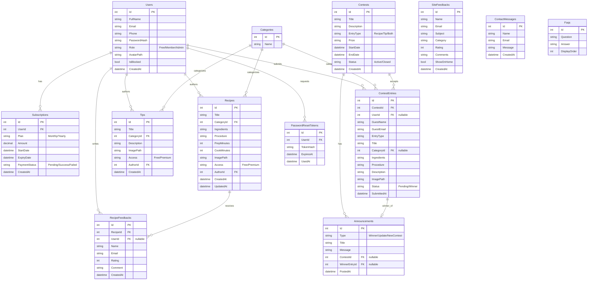

# JamesThewDB Database Documentation

## ER Diagram

## Data Dictionary

### Users
- **Id**: int, Primary Key.
- **FullName**: string, max length 100, required.
- **Email**: string, max length 255, required, unique.
- **Phone**: string, max length 20, nullable.
- **PasswordHash**: string, required.
- **Role**: string, max length 20, required (Free, Member, Admin).
- **AvatarPath**: string, max length 255, nullable.
- **IsBlocked**: bool, required.
- **CreatedAt**: datetime, required.

### PasswordResetTokens
- **Id**: int, Primary Key.
- **UserId**: int, Foreign Key to Users.
- **TokenHash**: string, max length 255, required.
- **ExpiresAt**: datetime, required.
- **UsedAt**: datetime, nullable.

### Subscriptions
- **Id**: int, Primary Key.
- **UserId**: int, Foreign Key to Users.
- **Plan**: string, max length 50, required (Monthly/Yearly).
- **Amount**: decimal(18, 2), required.
- **StartDate**: datetime, required.
- **ExpiryDate**: datetime, required.
- **PaymentStatus**: string, max length 50, required (Pending/Success/Failed).
- **CreatedAt**: datetime, required.

### Categories
- **Id**: int, Primary Key.
- **Name**: string, max length 100, required.

### Recipes
- **Id**: int, Primary Key.
- **Title**: string, max length 200, required.
- **CategoryId**: int, Foreign Key to Categories.
- **Ingredients**: string, required.
- **Procedure**: string, required.
- **PrepMinutes**: int, required.
- **CookMinutes**: int, required.
- **ImagePath**: string, max length 255, nullable.
- **Access**: string, max length 20, required (Free, Premium).
- **AuthorId**: int, Foreign Key to Users.
- **CreatedAt**: datetime, required.
- **UpdatedAt**: datetime, required.

### Tips
- **Id**: int, Primary Key.
- **Title**: string, max length 200, required.
- **CategoryId**: int, Foreign Key to Categories.
- **Description**: string, required.
- **ImagePath**: string, max length 255, nullable.
- **Access**: string, max length 20, required (Free, Premium).
- **AuthorId**: int, Foreign Key to Users.
- **CreatedAt**: datetime, required.

### Contests
- **Id**: int, Primary Key.
- **Title**: string, max length 200, required.
- **Description**: string, required.
- **EntryType**: string, max length 50, required (Recipe/Tip/Both).
- **Prize**: string, max length 255, nullable.
- **StartDate**: datetime, required.
- **EndDate**: datetime, required.
- **Status**: string, max length 20, required (Active/Closed).
- **CreatedAt**: datetime, required.

### ContestEntries
- **Id**: int, Primary Key.
- **ContestId**: int, Foreign Key to Contests.
- **UserId**: int, Foreign Key to Users, nullable.
- **GuestName**: string, max length 100, nullable.
- **GuestEmail**: string, max length 255, nullable.
- **EntryType**: string, max length 50, required.
- **Title**: string, max length 200, required.
- **CategoryId**: int, Foreign Key to Categories, nullable.
- **Ingredients**: string, nullable.
- **Procedure**: string, nullable.
- **Description**: string, nullable.
- **ImagePath**: string, max length 255, nullable.
- **Status**: string, max length 20, required (Pending/Winner).
- **SubmittedAt**: datetime, required.

### Announcements
- **Id**: int, Primary Key.
- **Type**: string, max length 50, required (Winner/Update/NewContest).
- **Title**: string, max length 200, required.
- **Message**: string, required.
- **ContestId**: int, Foreign Key to Contests, nullable.
- **WinnerEntryId**: int, Foreign Key to ContestEntries, nullable.
- **PostedAt**: datetime, required.

### RecipeFeedbacks
- **Id**: int, Primary Key.
- **RecipeId**: int, Foreign Key to Recipes.
- **UserId**: int, Foreign Key to Users, nullable.
- **Name**: string, max length 100, nullable.
- **Email**: string, max length 255, nullable.
- **Rating**: int, required (1 to 5).
- **Comment**: string, required.
- **CreatedAt**: datetime, required.

### SiteFeedbacks
- **Id**: int, Primary Key.
- **Name**: string, max length 100, required.
- **Email**: string, max length 255, required.
- **Subject**: string, max length 200, nullable.
- **Category**: string, max length 50, required.
- **Rating**: int, required.
- **Comments**: string, required.
- **ShowOnHome**: bool, required.
- **CreatedAt**: datetime, required.

### ContactMessages
- **Id**: int, Primary Key.
- **Name**: string, max length 100, required.
- **Email**: string, max length 255, required.
- **Message**: string, required.
- **CreatedAt**: datetime, required.

### Faqs
- **Id**: int, Primary Key.
- **Question**: string, max length 500, required.
- **Answer**: string, required.
- **DisplayOrder**: int, required.
