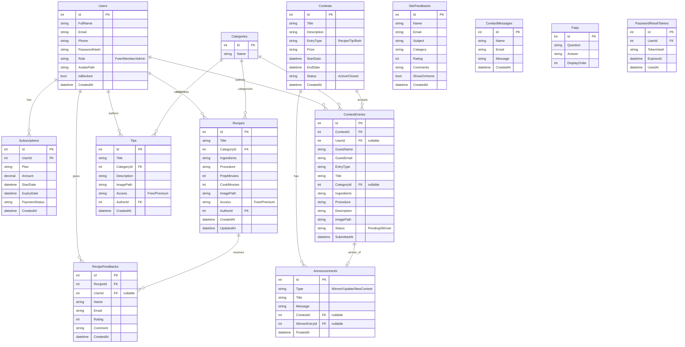

# Project Plan - JamesThew.com

## 1. Final Route Map and Structure

### Navbar
- Home `/Home/Index`
- About ▾
  - Chef James `/About/ChefJames`
  - Cookery Classes `/About/Classes`
  - Our Mission `/About/Mission`
- Recipes ▾
  - Free Recipes `/Recipe/Free`
  - Premium Recipes `/Recipe/Premium`
- Tips & Tricks ▾
  - Free Tips `/Tip/Free`
  - Premium Tips `/Tip/Premium`
- Contests ▾
  - Active Contests `/Contest/Active`
  - Past Winners `/Contest/Winners`
- Announcements `/Announcement/Index`
- Help ▾
  - FAQ `/Faq/Index`
  - Give Feedback `/Feedback/SiteFeedback`
  - Contact Us `/Contact/Index`
- Account (Guest): Login `/Account/Login`, Join Now `/Account/Register`
- Account (Logged In): Bell icon (Announcements) and Avatar dropdown (Dashboard `/Dashboard/Index`, Profile `/Dashboard/Profile`, Logout `/Account/Logout`)
- Admin (Logged In): Avatar dropdown Dashboard -> `/Admin/Dashboard`.

### Footer (4 columns)
1. **Brand & Biography**: Logo, tagline, short summary, social links.
2. **Culinary Quick Links**: About Chef James, Free Recipes, Free Tips, Active Contests, Weekend Classes, Subscription Plans `/Account/Plans`.
3. **Support & Policies**: FAQs, Site Feedback, Contact Us, Terms of Service `/Home/Terms`, Privacy Policy `/Home/Privacy`.
4. **Classes & Location**: Promo text, email, location.

## 2. Role and Access Matrix

| Page/Action | Visitor (Guest) | Free User | Paid Member | Admin (Chef James) |
|---|---|---|---|---|
| Home, About, FAQ, Announce, Contact, Legal | Yes | Yes | Yes | Yes |
| Plans | Yes | Yes | Yes | Yes |
| Login, RegisterFree, Join Now (Paid) | Yes | No (redirect to Dashboard) | No | No |
| Free Recipes & Free Tips | Yes | Yes | Yes | Yes |
| Premium Recipes & Premium Tips | Blurred/Lock | Blurred/Lock | Yes | Yes |
| Recipe/Tip Details | Yes (Blurred if Premium) | Yes (Blurred if Premium) | Yes | Yes |
| Give Recipe Feedback, Site Feedback | Yes (Requires Name/Email) | Yes | Yes | Yes |
| Active Contests (view) | Yes | Yes | Yes | Yes |
| Submit Contest Entry | Yes (Requires Name/Email) | Yes | Yes | No |
| Member Dashboard (Profile, My Entries, Subscription) | No | Yes | Yes | Yes |
| Member Dashboard (Add Recipe, Add Tip, My Recipes, My Tips, Edit Recipe/Tip) | No | No ("Upgrade to post") | Yes | Yes |
| Admin Panel (Dashboard, Recipes, Tips, Contests, Entries, Announcements, Feedbacks, Users) | No | No | No | Yes |
| Admin Profile | No | No | No | Yes (inside _AdminLayout) |

**Note**: Free User and expired Member MUST be able to open Plans and an upgrade/renew payment flow (`/Dashboard/Subscription` and checkout that reuses the 3-step payment UI for an existing account: plan choice + simulated payment, no re-registration).

## 3. Data Model (ER Diagram)

## 4. Page Spec Cards

### Feedback - Admin Dashboard - JamesThew.com
- **Route:** `/Admin/Feedbacks`
- **Controller.Action:** (TBD based on route)
- **View:** (Matches action)
- **ViewModel:** (Matches view data needs)
- **Data read/written:** (Based on SRS)
- **Who can access:** (See Role Matrix)
- **UI states:** Empty, locked (if applicable), validation error, success
- **Responsive notes:** Mobile hamburger menu, stack columns
- **Acceptance checklist:** Renders correctly, matches Stitch design, all buttons work, responsive.

### Premium Recipes (Guest) - JamesThew.com
- **Route:** `/Recipe/Premium (visitor / free user, locked state)`
- **Controller.Action:** (TBD based on route)
- **View:** (Matches action)
- **ViewModel:** (Matches view data needs)
- **Data read/written:** (Based on SRS)
- **Who can access:** (See Role Matrix)
- **UI states:** Empty, locked (if applicable), validation error, success
- **Responsive notes:** Mobile hamburger menu, stack columns
- **Acceptance checklist:** Renders correctly, matches Stitch design, all buttons work, responsive.

### Manage Members - Admin Dashboard - JamesThew.com
- **Route:** `/Admin/Users`
- **Controller.Action:** (TBD based on route)
- **View:** (Matches action)
- **ViewModel:** (Matches view data needs)
- **Data read/written:** (Based on SRS)
- **Who can access:** (See Role Matrix)
- **UI states:** Empty, locked (if applicable), validation error, success
- **Responsive notes:** Mobile hamburger menu, stack columns
- **Acceptance checklist:** Renders correctly, matches Stitch design, all buttons work, responsive.

### Recipe Details - JamesThew.com (Mobile)
- **Route:** `/Recipe/Details/{id} (mobile reference)`
- **Controller.Action:** (TBD based on route)
- **View:** (Matches action)
- **ViewModel:** (Matches view data needs)
- **Data read/written:** (Based on SRS)
- **Who can access:** (See Role Matrix)
- **UI states:** Empty, locked (if applicable), validation error, success
- **Responsive notes:** Mobile hamburger menu, stack columns
- **Acceptance checklist:** Renders correctly, matches Stitch design, all buttons work, responsive.

### Contact Us - Help - JamesThew.com
- **Route:** `/Contact/Index`
- **Controller.Action:** (TBD based on route)
- **View:** (Matches action)
- **ViewModel:** (Matches view data needs)
- **Data read/written:** (Based on SRS)
- **Who can access:** (See Role Matrix)
- **UI states:** Empty, locked (if applicable), validation error, success
- **Responsive notes:** Mobile hamburger menu, stack columns
- **Acceptance checklist:** Renders correctly, matches Stitch design, all buttons work, responsive.

### Profile Settings - Dashboard - JamesThew.com
- **Route:** `/Dashboard/Profile (also /Admin/Profile)`
- **Controller.Action:** (TBD based on route)
- **View:** (Matches action)
- **ViewModel:** (Matches view data needs)
- **Data read/written:** (Based on SRS)
- **Who can access:** (See Role Matrix)
- **UI states:** Empty, locked (if applicable), validation error, success
- **Responsive notes:** Mobile hamburger menu, stack columns
- **Acceptance checklist:** Renders correctly, matches Stitch design, all buttons work, responsive.

### My Contest Entries - Dashboard - JamesThew.com
- **Route:** `/Dashboard/MyEntries`
- **Controller.Action:** (TBD based on route)
- **View:** (Matches action)
- **ViewModel:** (Matches view data needs)
- **Data read/written:** (Based on SRS)
- **Who can access:** (See Role Matrix)
- **UI states:** Empty, locked (if applicable), validation error, success
- **Responsive notes:** Mobile hamburger menu, stack columns
- **Acceptance checklist:** Renders correctly, matches Stitch design, all buttons work, responsive.

### Active Contests - Contests - JamesThew.com
- **Route:** `/Contest/Active`
- **Controller.Action:** (TBD based on route)
- **View:** (Matches action)
- **ViewModel:** (Matches view data needs)
- **Data read/written:** (Based on SRS)
- **Who can access:** (See Role Matrix)
- **UI states:** Empty, locked (if applicable), validation error, success
- **Responsive notes:** Mobile hamburger menu, stack columns
- **Acceptance checklist:** Renders correctly, matches Stitch design, all buttons work, responsive.

### Manage Contests - Admin Dashboard - JamesThew.com
- **Route:** `/Admin/Contests`
- **Controller.Action:** (TBD based on route)
- **View:** (Matches action)
- **ViewModel:** (Matches view data needs)
- **Data read/written:** (Based on SRS)
- **Who can access:** (See Role Matrix)
- **UI states:** Empty, locked (if applicable), validation error, success
- **Responsive notes:** Mobile hamburger menu, stack columns
- **Acceptance checklist:** Renders correctly, matches Stitch design, all buttons work, responsive.

### Our Mission - About - JamesThew.com
- **Route:** `/About/Mission`
- **Controller.Action:** (TBD based on route)
- **View:** (Matches action)
- **ViewModel:** (Matches view data needs)
- **Data read/written:** (Based on SRS)
- **Who can access:** (See Role Matrix)
- **UI states:** Empty, locked (if applicable), validation error, success
- **Responsive notes:** Mobile hamburger menu, stack columns
- **Acceptance checklist:** Renders correctly, matches Stitch design, all buttons work, responsive.

### Recipe Details (Guest Locked) - JamesThew.com
- **Route:** `/Recipe/Details/{id} (locked state)`
- **Controller.Action:** (TBD based on route)
- **View:** (Matches action)
- **ViewModel:** (Matches view data needs)
- **Data read/written:** (Based on SRS)
- **Who can access:** (See Role Matrix)
- **UI states:** Empty, locked (if applicable), validation error, success
- **Responsive notes:** Mobile hamburger menu, stack columns
- **Acceptance checklist:** Renders correctly, matches Stitch design, all buttons work, responsive.

### Announcements - Admin Dashboard - JamesThew.com
- **Route:** `/Admin/Announcements`
- **Controller.Action:** (TBD based on route)
- **View:** (Matches action)
- **ViewModel:** (Matches view data needs)
- **Data read/written:** (Based on SRS)
- **Who can access:** (See Role Matrix)
- **UI states:** Empty, locked (if applicable), validation error, success
- **Responsive notes:** Mobile hamburger menu, stack columns
- **Acceptance checklist:** Renders correctly, matches Stitch design, all buttons work, responsive.

### Recipes - Admin Dashboard - JamesThew.com
- **Route:** `/Admin/Recipes`
- **Controller.Action:** (TBD based on route)
- **View:** (Matches action)
- **ViewModel:** (Matches view data needs)
- **Data read/written:** (Based on SRS)
- **Who can access:** (See Role Matrix)
- **UI states:** Empty, locked (if applicable), validation error, success
- **Responsive notes:** Mobile hamburger menu, stack columns
- **Acceptance checklist:** Renders correctly, matches Stitch design, all buttons work, responsive.

### Announcements - JamesThew.com
- **Route:** `/Announcement/Index`
- **Controller.Action:** (TBD based on route)
- **View:** (Matches action)
- **ViewModel:** (Matches view data needs)
- **Data read/written:** (Based on SRS)
- **Who can access:** (See Role Matrix)
- **UI states:** Empty, locked (if applicable), validation error, success
- **Responsive notes:** Mobile hamburger menu, stack columns
- **Acceptance checklist:** Renders correctly, matches Stitch design, all buttons work, responsive.

### Premium Tips (Guest) - Tips & Tricks - JamesThew.com
- **Route:** `/Tip/Premium (locked state; unlocked = same markup without blur)`
- **Controller.Action:** (TBD based on route)
- **View:** (Matches action)
- **ViewModel:** (Matches view data needs)
- **Data read/written:** (Based on SRS)
- **Who can access:** (See Role Matrix)
- **UI states:** Empty, locked (if applicable), validation error, success
- **Responsive notes:** Mobile hamburger menu, stack columns
- **Acceptance checklist:** Renders correctly, matches Stitch design, all buttons work, responsive.

### Home - JamesThew.com
- **Route:** `/Home/Index`
- **Controller.Action:** (TBD based on route)
- **View:** (Matches action)
- **ViewModel:** (Matches view data needs)
- **Data read/written:** (Based on SRS)
- **Who can access:** (See Role Matrix)
- **UI states:** Empty, locked (if applicable), validation error, success
- **Responsive notes:** Mobile hamburger menu, stack columns
- **Acceptance checklist:** Renders correctly, matches Stitch design, all buttons work, responsive.

### Give Feedback - Help - JamesThew.com
- **Route:** `/Feedback/SiteFeedback`
- **Controller.Action:** (TBD based on route)
- **View:** (Matches action)
- **ViewModel:** (Matches view data needs)
- **Data read/written:** (Based on SRS)
- **Who can access:** (See Role Matrix)
- **UI states:** Empty, locked (if applicable), validation error, success
- **Responsive notes:** Mobile hamburger menu, stack columns
- **Acceptance checklist:** Renders correctly, matches Stitch design, all buttons work, responsive.

### My Tips - Dashboard - JamesThew.com
- **Route:** `/Dashboard/MyTips`
- **Controller.Action:** (TBD based on route)
- **View:** (Matches action)
- **ViewModel:** (Matches view data needs)
- **Data read/written:** (Based on SRS)
- **Who can access:** (See Role Matrix)
- **UI states:** Empty, locked (if applicable), validation error, success
- **Responsive notes:** Mobile hamburger menu, stack columns
- **Acceptance checklist:** Renders correctly, matches Stitch design, all buttons work, responsive.

### Chef James - About - JamesThew.com
- **Route:** `/About/ChefJames`
- **Controller.Action:** (TBD based on route)
- **View:** (Matches action)
- **ViewModel:** (Matches view data needs)
- **Data read/written:** (Based on SRS)
- **Who can access:** (See Role Matrix)
- **UI states:** Empty, locked (if applicable), validation error, success
- **Responsive notes:** Mobile hamburger menu, stack columns
- **Acceptance checklist:** Renders correctly, matches Stitch design, all buttons work, responsive.

### Add Tip - Dashboard - JamesThew.com
- **Route:** `/Dashboard/AddTip`
- **Controller.Action:** (TBD based on route)
- **View:** (Matches action)
- **ViewModel:** (Matches view data needs)
- **Data read/written:** (Based on SRS)
- **Who can access:** (See Role Matrix)
- **UI states:** Empty, locked (if applicable), validation error, success
- **Responsive notes:** Mobile hamburger menu, stack columns
- **Acceptance checklist:** Renders correctly, matches Stitch design, all buttons work, responsive.

### Entries & Winners - Admin Dashboard - JamesThew.com
- **Route:** `/Admin/Entries`
- **Controller.Action:** (TBD based on route)
- **View:** (Matches action)
- **ViewModel:** (Matches view data needs)
- **Data read/written:** (Based on SRS)
- **Who can access:** (See Role Matrix)
- **UI states:** Empty, locked (if applicable), validation error, success
- **Responsive notes:** Mobile hamburger menu, stack columns
- **Acceptance checklist:** Renders correctly, matches Stitch design, all buttons work, responsive.

### Add Recipe - Admin Dashboard - JamesThew.com
- **Route:** `/Admin/RecipeForm (create + edit)`
- **Controller.Action:** (TBD based on route)
- **View:** (Matches action)
- **ViewModel:** (Matches view data needs)
- **Data read/written:** (Based on SRS)
- **Who can access:** (See Role Matrix)
- **UI states:** Empty, locked (if applicable), validation error, success
- **Responsive notes:** Mobile hamburger menu, stack columns
- **Acceptance checklist:** Renders correctly, matches Stitch design, all buttons work, responsive.

### Submit Contest Entry - Contests - JamesThew.com
- **Route:** `/Contest/Submit`
- **Controller.Action:** (TBD based on route)
- **View:** (Matches action)
- **ViewModel:** (Matches view data needs)
- **Data read/written:** (Based on SRS)
- **Who can access:** (See Role Matrix)
- **UI states:** Empty, locked (if applicable), validation error, success
- **Responsive notes:** Mobile hamburger menu, stack columns
- **Acceptance checklist:** Renders correctly, matches Stitch design, all buttons work, responsive.

### Subscription - Dashboard - JamesThew.com
- **Route:** `/Dashboard/Subscription`
- **Controller.Action:** (TBD based on route)
- **View:** (Matches action)
- **ViewModel:** (Matches view data needs)
- **Data read/written:** (Based on SRS)
- **Who can access:** (See Role Matrix)
- **UI states:** Empty, locked (if applicable), validation error, success
- **Responsive notes:** Mobile hamburger menu, stack columns
- **Acceptance checklist:** Renders correctly, matches Stitch design, all buttons work, responsive.

### Add Recipe - Dashboard - JamesThew.com
- **Route:** `/Dashboard/AddRecipe`
- **Controller.Action:** (TBD based on route)
- **View:** (Matches action)
- **ViewModel:** (Matches view data needs)
- **Data read/written:** (Based on SRS)
- **Who can access:** (See Role Matrix)
- **UI states:** Empty, locked (if applicable), validation error, success
- **Responsive notes:** Mobile hamburger menu, stack columns
- **Acceptance checklist:** Renders correctly, matches Stitch design, all buttons work, responsive.

### Membership Plans - JamesThew.com
- **Route:** `/Account/Plans`
- **Controller.Action:** (TBD based on route)
- **View:** (Matches action)
- **ViewModel:** (Matches view data needs)
- **Data read/written:** (Based on SRS)
- **Who can access:** (See Role Matrix)
- **UI states:** Empty, locked (if applicable), validation error, success
- **Responsive notes:** Mobile hamburger menu, stack columns
- **Acceptance checklist:** Renders correctly, matches Stitch design, all buttons work, responsive.

### Tip Details - Tips & Tricks - JamesThew.com
- **Route:** `/Tip/Details/{id}`
- **Controller.Action:** (TBD based on route)
- **View:** (Matches action)
- **ViewModel:** (Matches view data needs)
- **Data read/written:** (Based on SRS)
- **Who can access:** (See Role Matrix)
- **UI states:** Empty, locked (if applicable), validation error, success
- **Responsive notes:** Mobile hamburger menu, stack columns
- **Acceptance checklist:** Renders correctly, matches Stitch design, all buttons work, responsive.

### Recipe Details - JamesThew.com
- **Route:** `/Recipe/Details/{id}`
- **Controller.Action:** (TBD based on route)
- **View:** (Matches action)
- **ViewModel:** (Matches view data needs)
- **Data read/written:** (Based on SRS)
- **Who can access:** (See Role Matrix)
- **UI states:** Empty, locked (if applicable), validation error, success
- **Responsive notes:** Mobile hamburger menu, stack columns
- **Acceptance checklist:** Renders correctly, matches Stitch design, all buttons work, responsive.

### Overview - Dashboard - JamesThew.com
- **Route:** `/Dashboard/Index`
- **Controller.Action:** (TBD based on route)
- **View:** (Matches action)
- **ViewModel:** (Matches view data needs)
- **Data read/written:** (Based on SRS)
- **Who can access:** (See Role Matrix)
- **UI states:** Empty, locked (if applicable), validation error, success
- **Responsive notes:** Mobile hamburger menu, stack columns
- **Acceptance checklist:** Renders correctly, matches Stitch design, all buttons work, responsive.

### Overview - Admin Dashboard - JamesThew.com
- **Route:** `/Admin/Dashboard`
- **Controller.Action:** (TBD based on route)
- **View:** (Matches action)
- **ViewModel:** (Matches view data needs)
- **Data read/written:** (Based on SRS)
- **Who can access:** (See Role Matrix)
- **UI states:** Empty, locked (if applicable), validation error, success
- **Responsive notes:** Mobile hamburger menu, stack columns
- **Acceptance checklist:** Renders correctly, matches Stitch design, all buttons work, responsive.

### Home - JamesThew.com (Mobile)
- **Route:** `/Home/Index (mobile reference)`
- **Controller.Action:** (TBD based on route)
- **View:** (Matches action)
- **ViewModel:** (Matches view data needs)
- **Data read/written:** (Based on SRS)
- **Who can access:** (See Role Matrix)
- **UI states:** Empty, locked (if applicable), validation error, success
- **Responsive notes:** Mobile hamburger menu, stack columns
- **Acceptance checklist:** Renders correctly, matches Stitch design, all buttons work, responsive.

### Free Recipes - Recipes - JamesThew.com
- **Route:** `/Recipe/Free`
- **Controller.Action:** (TBD based on route)
- **View:** (Matches action)
- **ViewModel:** (Matches view data needs)
- **Data read/written:** (Based on SRS)
- **Who can access:** (See Role Matrix)
- **UI states:** Empty, locked (if applicable), validation error, success
- **Responsive notes:** Mobile hamburger menu, stack columns
- **Acceptance checklist:** Renders correctly, matches Stitch design, all buttons work, responsive.

### Free Tips - Tips & Tricks - JamesThew.com
- **Route:** `/Tip/Free`
- **Controller.Action:** (TBD based on route)
- **View:** (Matches action)
- **ViewModel:** (Matches view data needs)
- **Data read/written:** (Based on SRS)
- **Who can access:** (See Role Matrix)
- **UI states:** Empty, locked (if applicable), validation error, success
- **Responsive notes:** Mobile hamburger menu, stack columns
- **Acceptance checklist:** Renders correctly, matches Stitch design, all buttons work, responsive.

### Premium Recipes (Member) - JamesThew.com
- **Route:** `/Recipe/Premium (member / admin, unlocked state)`
- **Controller.Action:** (TBD based on route)
- **View:** (Matches action)
- **ViewModel:** (Matches view data needs)
- **Data read/written:** (Based on SRS)
- **Who can access:** (See Role Matrix)
- **UI states:** Empty, locked (if applicable), validation error, success
- **Responsive notes:** Mobile hamburger menu, stack columns
- **Acceptance checklist:** Renders correctly, matches Stitch design, all buttons work, responsive.

### Join Now - Registration & Membership - JamesThew.com
- **Route:** `/Account/Register`
- **Controller.Action:** (TBD based on route)
- **View:** (Matches action)
- **ViewModel:** (Matches view data needs)
- **Data read/written:** (Based on SRS)
- **Who can access:** (See Role Matrix)
- **UI states:** Empty, locked (if applicable), validation error, success
- **Responsive notes:** Mobile hamburger menu, stack columns
- **Acceptance checklist:** Renders correctly, matches Stitch design, all buttons work, responsive.

### Forgot Password - JamesThew.com
- **Route:** `/Account/ForgotPassword`
- **Controller.Action:** (TBD based on route)
- **View:** (Matches action)
- **ViewModel:** (Matches view data needs)
- **Data read/written:** (Based on SRS)
- **Who can access:** (See Role Matrix)
- **UI states:** Empty, locked (if applicable), validation error, success
- **Responsive notes:** Mobile hamburger menu, stack columns
- **Acceptance checklist:** Renders correctly, matches Stitch design, all buttons work, responsive.

### Terms of Service & Privacy - JamesThew.com
- **Route:** `/Home/Terms and /Home/Privacy (one template)`
- **Controller.Action:** (TBD based on route)
- **View:** (Matches action)
- **ViewModel:** (Matches view data needs)
- **Data read/written:** (Based on SRS)
- **Who can access:** (See Role Matrix)
- **UI states:** Empty, locked (if applicable), validation error, success
- **Responsive notes:** Mobile hamburger menu, stack columns
- **Acceptance checklist:** Renders correctly, matches Stitch design, all buttons work, responsive.

### FAQ - Help - JamesThew.com
- **Route:** `/Faq/Index`
- **Controller.Action:** (TBD based on route)
- **View:** (Matches action)
- **ViewModel:** (Matches view data needs)
- **Data read/written:** (Based on SRS)
- **Who can access:** (See Role Matrix)
- **UI states:** Empty, locked (if applicable), validation error, success
- **Responsive notes:** Mobile hamburger menu, stack columns
- **Acceptance checklist:** Renders correctly, matches Stitch design, all buttons work, responsive.

### Manage Tips - Admin Dashboard - JamesThew.com
- **Route:** `/Admin/Tips`
- **Controller.Action:** (TBD based on route)
- **View:** (Matches action)
- **ViewModel:** (Matches view data needs)
- **Data read/written:** (Based on SRS)
- **Who can access:** (See Role Matrix)
- **UI states:** Empty, locked (if applicable), validation error, success
- **Responsive notes:** Mobile hamburger menu, stack columns
- **Acceptance checklist:** Renders correctly, matches Stitch design, all buttons work, responsive.

### Past Winners - Contests - JamesThew.com
- **Route:** `/Contest/Winners`
- **Controller.Action:** (TBD based on route)
- **View:** (Matches action)
- **ViewModel:** (Matches view data needs)
- **Data read/written:** (Based on SRS)
- **Who can access:** (See Role Matrix)
- **UI states:** Empty, locked (if applicable), validation error, success
- **Responsive notes:** Mobile hamburger menu, stack columns
- **Acceptance checklist:** Renders correctly, matches Stitch design, all buttons work, responsive.

### Cookery Classes - About - JamesThew.com
- **Route:** `/About/Classes`
- **Controller.Action:** (TBD based on route)
- **View:** (Matches action)
- **ViewModel:** (Matches view data needs)
- **Data read/written:** (Based on SRS)
- **Who can access:** (See Role Matrix)
- **UI states:** Empty, locked (if applicable), validation error, success
- **Responsive notes:** Mobile hamburger menu, stack columns
- **Acceptance checklist:** Renders correctly, matches Stitch design, all buttons work, responsive.

### Add Tip - Admin Dashboard - JamesThew.com
- **Route:** `/Admin/TipForm (create + edit)`
- **Controller.Action:** (TBD based on route)
- **View:** (Matches action)
- **ViewModel:** (Matches view data needs)
- **Data read/written:** (Based on SRS)
- **Who can access:** (See Role Matrix)
- **UI states:** Empty, locked (if applicable), validation error, success
- **Responsive notes:** Mobile hamburger menu, stack columns
- **Acceptance checklist:** Renders correctly, matches Stitch design, all buttons work, responsive.

### Login - JamesThew.com
- **Route:** `/Account/Login`
- **Controller.Action:** (TBD based on route)
- **View:** (Matches action)
- **ViewModel:** (Matches view data needs)
- **Data read/written:** (Based on SRS)
- **Who can access:** (See Role Matrix)
- **UI states:** Empty, locked (if applicable), validation error, success
- **Responsive notes:** Mobile hamburger menu, stack columns
- **Acceptance checklist:** Renders correctly, matches Stitch design, all buttons work, responsive.

### My Recipes - Dashboard - JamesThew.com
- **Route:** `/Dashboard/MyRecipes`
- **Controller.Action:** (TBD based on route)
- **View:** (Matches action)
- **ViewModel:** (Matches view data needs)
- **Data read/written:** (Based on SRS)
- **Who can access:** (See Role Matrix)
- **UI states:** Empty, locked (if applicable), validation error, success
- **Responsive notes:** Mobile hamburger menu, stack columns
- **Acceptance checklist:** Renders correctly, matches Stitch design, all buttons work, responsive.

### Free Register - JamesThew.com
- **Route:** `/Account/RegisterFree`
- **Controller.Action:** (TBD based on route)
- **View:** (Matches action)
- **ViewModel:** (Matches view data needs)
- **Data read/written:** (Based on SRS)
- **Who can access:** (See Role Matrix)
- **UI states:** Empty, locked (if applicable), validation error, success
- **Responsive notes:** Mobile hamburger menu, stack columns
- **Acceptance checklist:** Renders correctly, matches Stitch design, all buttons work, responsive.

### Edit Recipe - Dashboard - JamesThew.com
- **Route:** `/Dashboard/EditRecipe/{id}`
- **Controller.Action:** (TBD based on route)
- **View:** (Matches action)
- **ViewModel:** (Matches view data needs)
- **Data read/written:** (Based on SRS)
- **Who can access:** (See Role Matrix)
- **UI states:** Empty, locked (if applicable), validation error, success
- **Responsive notes:** Mobile hamburger menu, stack columns
- **Acceptance checklist:** Renders correctly, matches Stitch design, all buttons work, responsive.

### Edit Tip - Dashboard - JamesThew.com
- **Route:** `/Dashboard/EditTip/{id}`
- **Controller.Action:** (TBD based on route)
- **View:** (Matches action)
- **ViewModel:** (Matches view data needs)
- **Data read/written:** (Based on SRS)
- **Who can access:** (See Role Matrix)
- **UI states:** Empty, locked (if applicable), validation error, success
- **Responsive notes:** Mobile hamburger menu, stack columns
- **Acceptance checklist:** Renders correctly, matches Stitch design, all buttons work, responsive.

## 5. Build Order (Phases)
### Phase 1: Project Setup + Layouts (Phase B-1)
- New solution, folder structure, design tokens, shared CSS.
- Shared layouts (`_Layout`, `_DashboardLayout`, `_AdminLayout`) and partials (navbar, footer).
- Downloaded images in place.

### Phase 2: Database
- New database `JamesThewDB` via EF Core migrations.
- Models, DbContext, Seed Data.

### Phase 3: Authentication
- Login (`/Account/Login`)
- Forgot Password (`/Account/ForgotPassword`)
- Register Free (`/Account/RegisterFree`)
- Join Now (`/Account/Register`)

### Phase 4: Public Pages
- Home (`/Home/Index`)
- Chef James (`/About/ChefJames`)
- Cookery Classes (`/About/Classes`)
- Our Mission (`/About/Mission`)
- Free Recipes (`/Recipe/Free`), Premium Recipes (`/Recipe/Premium`), Recipe Details (`/Recipe/Details/{id}`)
- Free Tips (`/Tip/Free`), Premium Tips (`/Tip/Premium`), Tip Details (`/Tip/Details/{id}`)
- Active Contests (`/Contest/Active`), Past Winners (`/Contest/Winners`), Submit Contest Entry (`/Contest/Submit`)
- Announcements (`/Announcement/Index`)
- FAQ (`/Faq/Index`)
- Give Feedback (`/Feedback/SiteFeedback`)
- Contact Us (`/Contact/Index`)
- Plans (`/Account/Plans`)
- Terms & Privacy (`/Home/Terms`, `/Home/Privacy`)

### Phase 5: Member Dashboard
- Overview (`/Dashboard/Index`)
- My Recipes (`/Dashboard/MyRecipes`)
- Add/Edit Recipe (`/Dashboard/AddRecipe`, `/Dashboard/EditRecipe/{id}`)
- My Tips (`/Dashboard/MyTips`)
- Add/Edit Tip (`/Dashboard/AddTip`, `/Dashboard/EditTip/{id}`)
- My Entries (`/Dashboard/MyEntries`)
- Subscription (`/Dashboard/Subscription`)
- Profile Settings (`/Dashboard/Profile`)

### Phase 6: Admin Panel
- Overview (`/Admin/Dashboard`)
- Manage Recipes (`/Admin/Recipes`)
- Add/Edit Recipe (`/Admin/RecipeForm`)
- Manage Tips (`/Admin/Tips`)
- Add/Edit Tip (`/Admin/TipForm`)
- Manage Contests (`/Admin/Contests`)
- Entries & Winners (`/Admin/Entries`)
- Announcements (`/Admin/Announcements`)
- Feedbacks (`/Admin/Feedbacks`)
- Manage Members (`/Admin/Users`)
- Admin Profile (`/Admin/Profile`)

### Phase 7: Polish & Phase 8: Testing
- 404/403/500 error pages.
- Validation, responsive fixes, end-to-end testing.

## 6. Risks
- **Asset Links**: Need to ensure all static links match the local `wwwroot/images` structure exactly.
- **Role Switching**: Need to properly clear cookies/session or redirect if a user tries to access a page they don't have roles for.
- **Complex UI**: The blurred "Premium Locked" state requires careful CSS overlay and z-index handling to match Stitch precisely.
